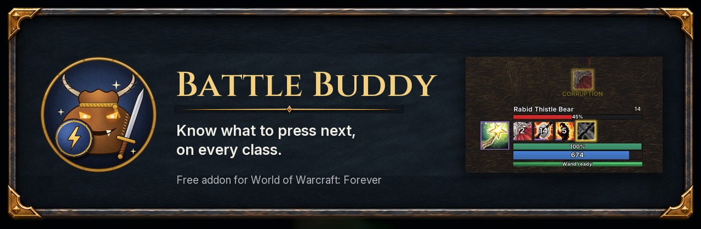
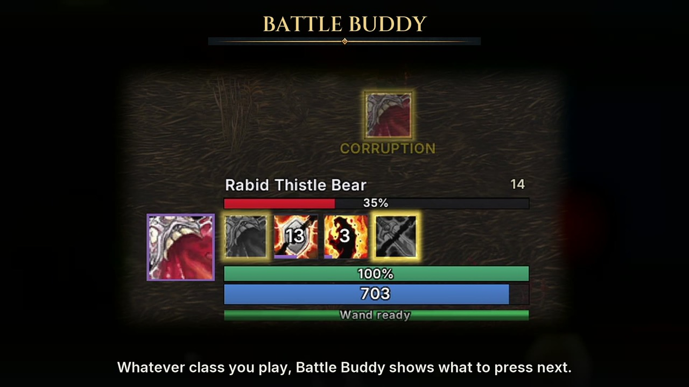
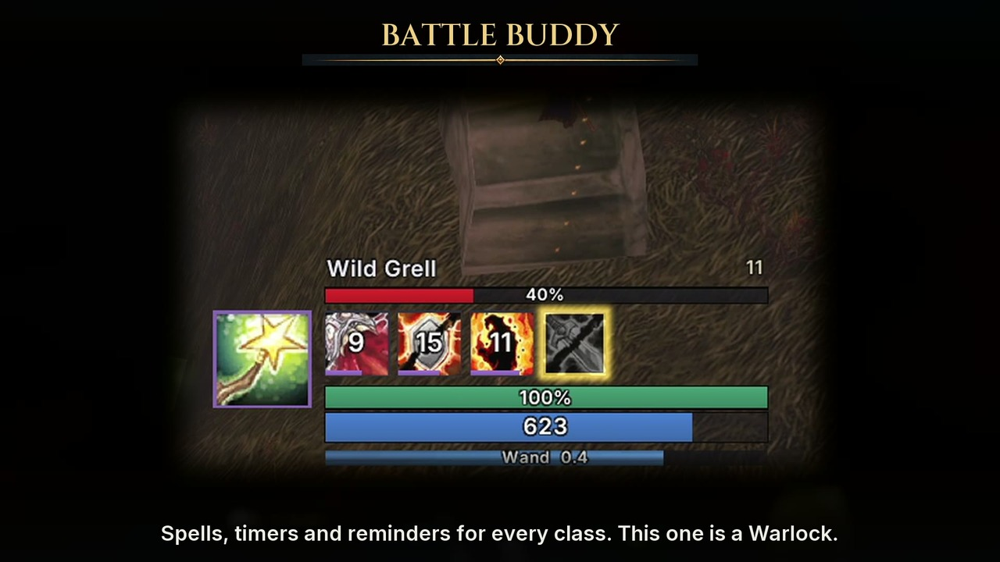
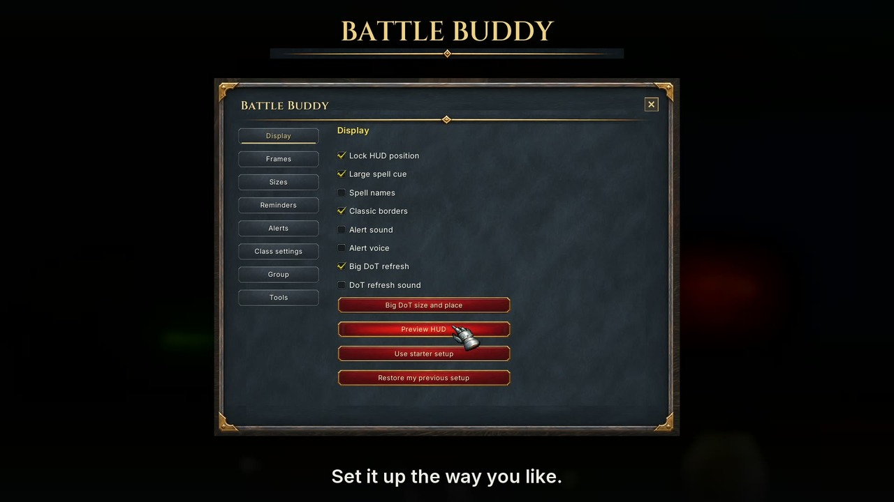
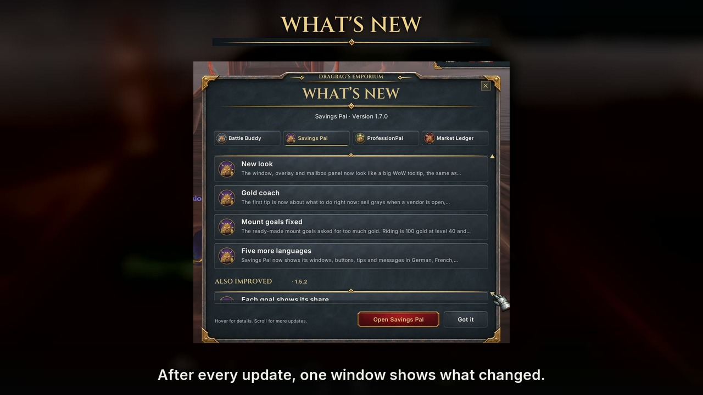

# Battle Buddy

**[Get it on CurseForge](https://www.curseforge.com/wow/addons/dbagsalerts)** · [Download the zip](https://github.com/Yungslaya/DBagsAlerts/releases/latest/download/DBagsAlerts.zip) · [All changes](CHANGELOG.md)

**See the fight at a glance**

Battle Buddy puts what matters in a fight right next to your character: your health and power, the next button to press, buffs and DoTs to refresh, and big warnings when something goes wrong. Big icons, few words, easy to read.

**[Watch the video on YouTube](https://youtu.be/2W8BDpfz9jg)**

## At a glance

- The next button to press, right under your character
- Timers on your DoTs and debuffs, and a big reminder when one needs casting again
- Big warnings for low health, loose mobs and casts to stop
- A colored dot on every mob shows who it is hitting
- Buff, food and weapon stone reminders
- Optional voice: it can say danger alerts out loud
- A reminder to visit your trainer when new spell ranks are ready
- Dungeon helpers: healer mana, party cooldowns, a too-far warning
- Type **/bbuddy** to start

## Made for every class

All nine: Warrior, Paladin, Druid, Warlock, Priest, Mage, Hunter, Rogue and Shaman. Each class gets its own spells, timers and reminders. The pictures here show a Warlock.

Warrior, Paladin, Druid and Warlock have had the most play. Mage, Hunter, Rogue and Shaman are newer, so tell us what feels wrong.

## Set it up the way you like

Move it, resize each part, turn pieces on or off, or start from the simple starter setup. Pet, healer and party tools have their own pages.

## New: one look, and a What's new window

Every window now has the same stone frame, gold corners and clean text as our other addons. After an update, one window shows what changed, with a tab for each of our addons you have. Type **/bbuddy news** to see it again.

## Languages

English, German, French, Spanish, Russian and Simplified Chinese. Cues show the game's own spell names in your language.

Only English has been tested in the game. The other languages are new: some windows and chat messages are still in English, and there may be mistakes. If something looks wrong in your language, please post it in the comments.

## Commands

- **/bbuddy** (or the old /dba) opens Settings. **/dba starter** shows the simple starting setup.
- **/bbuddy news** shows what changed.
- **/pa voice** turns voice alerts on or off. **/bbtrain** turns the trainer reminder on or off.
- **/dbapet** pet controls. **/dbaparty** party tools.
- **/dbadebug** turns on logging and copies a report if something breaks.

Battle Buddy only shows you things. It never presses a button for you.

Battle Buddy used to be called DBagsAlerts. Same addon, same settings.

## More from Dragbag's Emporium

Four free addons with one shared look. Use one, or all four.

- **[ProfessionPal](https://www.curseforge.com/wow/addons/professionpal)**: one clear next step for every profession, and where to farm it.
- **[Market Ledger](https://www.curseforge.com/wow/addons/market-ledger)**: what to sell, vendor and keep, right at the Auction House.
- **[Savings Pal](https://www.curseforge.com/wow/addons/drags-hedge-fund)**: sets gold aside for your mount every time you earn.

## What's new

- **1.3.1:** DoT tiles no longer go grey while the DoT is still on the mob, and the big DoT reminder stays quiet on dying open-world mobs. Type `/reload` after updating.
- **1.3.0:** New look for the settings windows, pet bars that match your own bars, and a What's new window after updates. Fully restart WoW after updating.
- **1.2.5:** The big DoT alert only reminds you to reapply DoTs already on the target, from their last 30%. Type `/reload` after updating.
- **1.2.4:** Immolate's timer no longer vanishes in combat. The big DoT alert can be moved anywhere (drag it), resized and made see-through. Type `/reload` after updating.
- **1.2.3:** Big DoT refresh alert in the middle of your screen, with a sound. Type `/reload` after updating.

[All changes](CHANGELOG.md)

## Install

1. Easiest: install **Battle Buddy** from [CurseForge](https://www.curseforge.com/wow/addons/dbagsalerts) with the CurseForge app.
2. WowUp: Get Addons, Install from URL, and paste `https://github.com/Yungslaya/DBagsAlerts`.
3. By hand: [download the zip](https://github.com/Yungslaya/DBagsAlerts/releases/latest/download/DBagsAlerts.zip), unzip it, and put the `DBagsAlerts` folder in `World of Warcraft\_forever_\Interface\AddOns`.

Fully restart WoW after installing.

## More details

Open the full guide

### Party cooldown repair

`/dbaparty` separates Show party cooldowns from Share my cooldowns. Sharing starts on in five-player dungeons, even when the sender's own icon display is off; switch it off to opt out. No traffic outside the dungeon scope.

No-addon members: readable casts and active defensive buffs seed estimated timers. Repeated buff scans do not restart a timer. Hidden identities are not decoded; missed uses, talents and resets can affect estimates.

Addon members: v2 messages carry readable cooldown snapshots and readiness, with a tagged own-cast estimate if live timing is restricted. Exact and estimated states stay distinct. Upgrade both clients to this build for the new messages; v1 reports are still accepted. `/dbaparty status` and `/dbadebug` include sync counters to diagnose missing reports or restricted casts.

### Starter setup

New installs keep the combat HUD, readable bars, spell cues, DoT timers and buff reminder. Optional target/cast replacement frames, cursor ring, aggro dots, stance/food/stone reminders, healer/party checks, party-distance screen flashes, pet replacement frame and follow helper start off. Native Blizzard frames stay visible. Custom sizing and sounds start off.

`/dba` → Display → Use starter setup, or `/dba starter`, previews this on an existing character. `/dba restore` restores the previous feature choices. `/reload` completes the frame change. Your macros, custom sizes/positions, timers and chosen follow name are retained. Existing users are never switched automatically.

Combat coverage: Protection Warrior; Protection Paladin with basic Retribution damage-mode cues; Feral Bear/Cat and Balance Druid; shared Affliction/Demonology/Destruction Warlock leveling cues. Restoration has basic upkeep/self-care, not party-healing guidance. Hunter has pet tools only; no Hunter rotation.

### What it does

- Big icons for what matters right now: danger (low HP, loose mobs, taunt, stop a cast), next button, buffs and debuffs to refresh.
- **Druid:** Bear (Primal Bite, Lacerate/Swipe, Maul, Demo Roar, Faerie Fire), Cat (Ravage from Prowl, Rip, Rake, Claw/Shred, Shifting Power), caster (Moonfire, Insect Swarm, Wrath, Hurricane), Mark of the Wild + Thorns, Rejuvenation before a pull, Innervate. From the Icy Veins WoW Forever druid guides.
- **Warlock:** Corruption, Bane of Agony (never early), Immolate, Siphon Life on mobs that will live; free Shadow Bolt (Nightfall); Conflagrate, Shadowburn, Searing Pain brand; Drain Life when low; Drain Soul on a dying mob when shards are low; Life Tap when mana is low and health is fine; pet out (unless Demonic Sacrifice), Demon Armor, Soul Link, curse on elites, Healthstone (eat it when low, make one when you have none). From the Icy Veins WoW Forever warlock guides.
- Health, power, threat and swing timer bars.
- Emergency cooldown row with proc glow.
- Target frame with cast bar. Right-click it for the normal menu.
- Aggro dot over every mob in a fight: green = it's on you, yellow = about to lose it, red = it's not hitting you.
- EAT button (Well Fed +5% XP), weapon stone button (Warrior, Paladin), cursor ring.
- Makes your macros in game: `/pa macros`.

### Commands

- `/pa` or `/dba` - settings
- `/pa macros` - make the macros
- `/pa unlock` - move it
- `/pa food` - why the EAT button is or isn't showing
- `/dbapet` - pet frame and controls (including Hunter pet support; no Hunter rotation)
- `/dbafollow` - follow name, key and movable status
- `/dbagroup` - group distance warning and pause key
- `/dbaparty` - party defensive placeholders, observed cooldowns and active buffs in five-player dungeons
- `/dbadebug` - error recording, Show Lua errors and copyable report
- `/dbadebug on` - start bounded debug recording
- `/dbadebug errors on` - show native Lua error popups

### Rules it follows

Alerts use Blizzard's addon API. Pet commands, spell buttons and Follow require your click or keypress; the addon never starts them on a timer. Follow uses the game's normal follow behavior.

### Credits

Swing timer technique from AKForeverCombatTimers (MIT). Textures are made by the scripts in `tools/`.

### Party cooldown estimates

Other players do not need the addon. Class spell placeholders are filtered by level and stay unconfirmed until observed. Public successful casts start base-cooldown estimates; higher ranks match by readable spell name. RDY~ means estimated ready, not confirmed availability. Training, talents, resets, pet availability, Forbearance and missed/restricted casts can affect actual use. Current self-reports from another DBagsAlerts user can improve accuracy, but are optional. A generic question-mark icon is never used for an absent addon.

Baseline sources: [Icy Veins Forever Warrior guide](https://www.icy-veins.com/wow-forever/protection-warrior-tank-pve-rotation-cooldowns-abilities), and its Forever spell database entries for [Divine Protection](https://db.icy-veins.com/wow-forever/spells/498), [Barkskin](https://db.icy-veins.com/wow-forever/spells/22812), [Death Coil](https://db.icy-veins.com/wow-forever/spells/6789), [Deterrence](https://db.icy-veins.com/wow-forever/spells/19263), [Fade](https://db.icy-veins.com/wow-forever/spells/10942), [Nature's Swiftness](https://db.icy-veins.com/wow-forever/spells/16188), [Ice Block](https://db.icy-veins.com/wow-forever/spells/11958) and [Evasion](https://db.icy-veins.com/wow-forever/spells/5277).

Debug records are opt-in and saved in DBagsAlertsDB.debugLog (30 grouped errors and 40 recent events). They include stack traces and addon/game context, with no chat-message collection or secret-value decoding. Error capture can identify other addons too; a generic error warning alone does not identify its source. Disabling recording restores the previous error handler when safe. Guarded timer failures back off and report once instead of throwing every frame.

